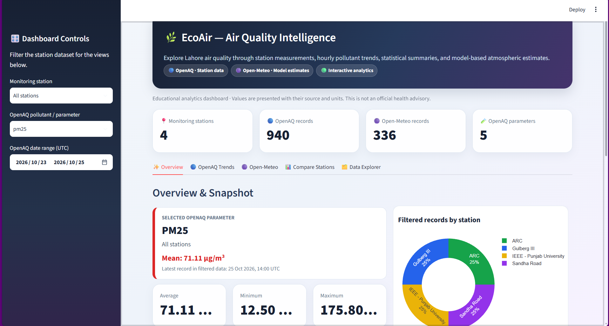

# 🌱 EcoAir — Air Quality & Environmental Analytics Dashboard

An environmental data analytics project that collects, validates, analyzes, and visualizes air quality data from multiple sources. EcoAir combines multi-station measurements, pollutant analysis, statistical exploration, and interactive visualizations to help investigate air pollution patterns and environmental conditions.

**Course:** Programming for AI  
**Project:** ETL + EDA Pipeline  
**Theme:** Air Quality & Public Health Tracker (Eco-Tech)  
**Focus:** Sensor Data Validation & Geospatial Analysis

---

## 📌 Project Overview

Air pollution is a major environmental and public health concern. Monitoring pollutants such as PM2.5, PM10, ozone, nitrogen dioxide, and sulphur dioxide helps us understand environmental conditions and identify pollution patterns.

EcoAir integrates datasets from **OpenAQ** and **Open-Meteo** and applies an ETL workflow involving data extraction, transformation, validation, storage, and exploratory data analysis.

The project also provides an interactive Streamlit dashboard where users can explore pollution trends, compare monitoring stations, examine statistical summaries, and investigate environmental measurements.

## 🎯 Project Objectives

- Collect environmental and air quality data through APIs.
- Implement an ETL pipeline for data extraction, transformation, validation, and storage.
- Validate data quality using **Pydantic**.
- Process and analyze datasets using **Pandas**.
- Store structured air quality measurements in an SQLite database.
- Perform exploratory data analysis (EDA).
- Identify trends, distributions, missing values, and relationships between environmental variables.
- Compare air quality measurements across monitoring stations.
- Build an interactive dashboard using Streamlit and Plotly.

## 📡 Data Sources

### 1. OpenAQ

[OpenAQ](https://openaq.org/) provides air quality measurements collected from monitoring stations.

EcoAir uses OpenAQ data for multi-station environmental analysis.

**Parameters included:**

- PM1
- PM2.5
- Temperature
- Relative Humidity
- UM003

**Monitoring stations:**

- ARC
- IEEE – Punjab University
- Sandha Road
- Gulberg III

The collected multi-station dataset contains **940 records** from four monitoring stations.

### 2. Open-Meteo Air Quality API

[Open-Meteo](https://open-meteo.com/) provides atmospheric and air quality data through its API.

EcoAir uses this dataset for pollutant analysis and environmental trend exploration.

**Pollutants analyzed:**

- PM10
- PM2.5
- Ozone (O₃)
- Nitrogen Dioxide (NO₂)
- Sulphur Dioxide (SO₂)
- Carbon Monoxide (CO)

The Open-Meteo dataset contains **336 records and 11 columns**, including timestamps, pollutant measurements, geographic coordinates, and data source information.

## ⚙️ ETL Pipeline

EcoAir implements an Extract, Transform, and Load (ETL) workflow.

### 1. Extract

- Retrieve air quality measurements from OpenAQ.
- Retrieve atmospheric and pollutant data from Open-Meteo.
- Store extracted data in raw CSV files.

### 2. Transform and Validate

Pandas and Pydantic are used to process and validate the collected data.

The process includes:

- Structuring raw API responses.
- Checking data types and required fields.
- Validating measurement records.
- Identifying invalid values and inconsistencies.
- Processing timestamps.
- Preparing cleaned datasets for analysis and storage.

### 3. Load

Validated OpenAQ measurements are stored in an SQLite database.

- **Database:** `air_quality.db`
- **Table:** `measurements`
- **Validated records:** 940

Cleaned datasets are also exported to CSV files for analysis and reuse.

## 🧹 Data Validation

EcoAir uses **Pydantic** to validate collected air quality records.

The validation pipeline checks the structure and expected data types of measurement records and separates valid records from invalid ones.

### OpenAQ validation results

| Metric | Result |
|---|---:|
| Total records processed | 940 |
| Valid records | 940 |
| Invalid records | 0 |
| Validation success | 100% |

The validated records are exported to a cleaned CSV dataset and loaded into SQLite.

Data validation is important because environmental datasets may contain missing values, inconsistent formats, unexpected readings, or invalid measurements that can affect analytical results.

## 📊 Exploratory Data Analysis (EDA)

EcoAir performs structured exploratory data analysis using Pandas and visualization libraries.

### OpenAQ Analysis

- Air quality variations across monitoring stations.
- PM2.5 measurement distributions.
- Differences in pollution levels between locations.
- Pollution trends over time.
- Station-level descriptive statistics.
- Comparisons of available environmental measurements.

### Open-Meteo Analysis

- Pollutant distributions.
- PM2.5 trends.
- PM10 trends.
- Missing data patterns.
- Correlations between pollutant measurements.
- Relationships between atmospheric pollutants.

### Statistical Analysis

The project calculates descriptive statistics, including:

- Mean
- Median
- Minimum
- Maximum
- Standard deviation
- Missing-value counts
- Correlation values

### Key OpenAQ PM2.5 Station Statistics

| Monitoring Station | Mean PM2.5 |
|---|---:|
| Sandha Road | 60.00 |
| IEEE – Punjab University | 70.66 |
| ARC | 73.80 |
| Gulberg III | 79.99 |

These statistics provide a comparison of PM2.5 measurements across the selected monitoring stations within the collected dataset.

## 📈 Dashboard Features

EcoAir provides an interactive dashboard built using **Streamlit** and **Plotly**.

The dashboard is organized into five main sections:

### 1. Overview
- Project overview.
- Environmental data summary.
- Key statistical metrics.
- Main dashboard visualizations.

### 2. OpenAQ Trends
- Multi-station air quality analysis.
- PM2.5 trends.
- Station-level exploration.
- Pollution data visualizations.

### 3. Open-Meteo Analysis
- Pollutant data exploration.
- PM2.5 and PM10 trends.
- Atmospheric pollutant comparisons.
- Statistical analysis.

### 4. Compare Stations
- Compare measurements across monitoring stations.
- Explore differences in station-level pollution statistics.
- Visual comparison of available measurements.

### 5. Data Explorer
- Interactive data exploration.
- Filter available measurements.
- Inspect collected records.
- Explore underlying datasets.

Additional functionality includes interactive charts, filters, statistical summaries, and data exploration.

## 🛠️ Technologies Used

| Technology | Purpose |
|---|---|
| Python | Core programming language |
| Pandas | Data cleaning, transformation, and analysis |
| Pydantic | Data validation and schema enforcement |
| SQLite | Structured data storage |
| Streamlit | Interactive dashboard development |
| Plotly | Interactive data visualizations |
| Matplotlib | Exploratory data visualizations |
| Requests | API data retrieval |
| OpenAQ API | Multi-station air quality data |
| Open-Meteo API | Atmospheric and pollutant data |
| Git & GitHub | Version control and project hosting |

## 📁 Project Structure

```text
EcoAir/
│
├── app.py
├── database.py
├── extract_openmeteo.py
├── validate_multi_station.py
├── analyze_multi_station.py
├── analyze_openmeteo.py
│
├── CSV datasets/
│   ├── air_quality_multi_station_raw.csv
│   ├── air_quality_multi_station_clean.csv
│   ├── air_quality_openmeteo_raw.csv
│   ├── openmeteo_descriptive_statistics.csv
│   ├── openmeteo_missing_values.csv
│   └── openmeteo_correlation_matrix.csv
│
├── EDA charts/
│   ├── pm25_station_comparison.png
│   ├── pm25_multi_station_trends.png
│   ├── pm25_over_time.png
│   ├── pm25_distribution.png
│   ├── openmeteo_pm25_trend.png
│   ├── openmeteo_pm10_trend.png
│   └── openmeteo_correlation_heatmap.png
│
├── submission_evidence/
│   ├── dashboard_screenshot.png
│   └── EcoAir Demo.webm
│
├── air_quality.db
├── requirements.txt
├── README.md
└── .gitignore
```

*Note: Generated datasets and analysis outputs may vary depending on the latest data collection and analysis runs.*

## 🚀 Installation and Setup

### Prerequisites

- Python installed
- Git installed
- Internet connection for API data collection

### 1. Clone the repository

```bash
git clone https://github.com/CodeX-PAI/EcoAir.git
```

### 2. Navigate to the project directory

```bash
cd EcoAir
```

### 3. Create a virtual environment

```bash
python -m venv .venv
```

### 4. Activate the virtual environment

**Windows PowerShell:**

```powershell
.\.venv\Scripts\Activate.ps1
```

**Windows Command Prompt:**

```cmd
.venv\Scripts\activate.bat
```

### 5. Install dependencies

```bash
pip install -r requirements.txt
```

### 6. Run the dashboard

```bash
streamlit run app.py
```

The dashboard will open in your local browser.

## 📦 Dependencies

Project dependencies are listed in `requirements.txt`.

Main libraries include:

- requests
- python-dotenv
- pydantic
- pandas
- matplotlib
- streamlit
- plotly

## 📷 Dashboard Preview

The following screenshot provides a preview of the EcoAir interactive dashboard.



## 🎥 Project Demo

Watch the project demonstration video to explore the EcoAir dashboard, including its visualizations, station comparisons, and interactive data exploration.

[▶ Watch the EcoAir Dashboard Demo](submission_evidence/EcoAir%20Demo.webm)

## 🌍 Project Significance

EcoAir demonstrates how data science and programming techniques can be applied to environmental monitoring.

By combining API-based data collection, validation, structured storage, statistical analysis, and interactive visualization, the project provides a practical workflow for exploring air quality data.

It also highlights the importance of data quality, exploratory analysis, and visualization in making environmental datasets more understandable.

## 👩‍💻 Academic Project

- **Course:** Programming for AI
- **Project:** ETL + EDA Pipeline
- **Project Theme:** Air Quality & Public Health Tracker (Eco-Tech)
- **Focus:** Sensor Data Validation & Geospatial Analysis

## 📄 License

This project was developed for academic and educational purposes.